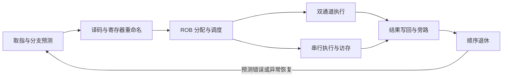

基于 RISC-V 的双通道乱序处理器
本项目是一款面向 FPGA 实现的 32 位 RISC-V 处理器，采用双指令取指、寄存器重命名、双整数执行通道和顺序退休架构。

处理器以 RV32I 为基础，支持整数乘除法、CSR 和位操作相关扩展，集成动态分支预测、指令与数据缓存、异常中断处理及基本外设接口，可用于嵌入式计算和任务控制。
处理器特性
项目	配置
指令集	RV32I、M、Zicsr、Zbb、Zbc
数据位宽	32 位
流水线	取指、译码/重命名、发射、执行/写回、退休五个逻辑阶段
指令取指	双指令取指
整数执行	双整数执行通道，支持乱序调度
指令退休	按程序顺序退休，满足条件时最多每周期退休两条
重排序缓冲区	10 项 ROB，按奇偶项分组
分支预测	动态方向预测、256 项 BTB、8 项返回地址栈
指令缓存	16 KiB，两路组相联
数据缓存	2 KiB，两路组相联
异常与中断	支持机器态 CSR、异常处理、中断处理及 MRET
外设	UART、定时器、按键和 LED
开发语言	Verilog / SystemVerilog
目标器件	紫光同创 PG2L200H FPGA

处理器架构
处理器按功能划分为取指、译码与重命名、发射、执行与写回、退休五个逻辑阶段。指令执行时间会随操作数依赖、访存和控制流恢复等情况变化。

双通道乱序执行
指令译码后进入重排序缓冲区。处理器依据指令年龄、操作数是否就绪及执行通道状态选择候选指令；较年轻的就绪指令可以先于尚未就绪的指令执行。

ROB 偶数项和奇数项分别对应两个整数执行通道。执行结果通过写回与旁路提供给后续指令，最终仍按程序顺序退休，以维护正确的架构状态。
分支预测与恢复
前端结合动态方向预测、分支目标缓冲表和返回地址栈预测控制流。预测信息随指令进入处理器，预测错误或发生异常时，处理器恢复正确的取指地址并清除相关推测状态。
缓存与访存
处理器分别配置两路组相联指令缓存和数据缓存，支持缓存未命中的数据回填。普通数据访问通过数据缓存连接片上存储器，外设访问通过存储器映射接口完成。

访存、CSR 和部分控制操作由串行执行通路处理，并与 ROB 的顺序退休机制配合，保证异常和外设访问的执行顺序。
性能指标
技术报告中的板上测试
以下数据来自项目技术报告中的纯软件 CoreMark 性能组测试。
指标	结果
FPGA 器件	PG2L200H
开发环境	PDS 2022.2-SP6.4
处理器频率	120 MHz
CoreMark 迭代次数	16,000
测试时间	16.409632 s
CoreMark	975.0371 CoreMark/s
执行效率	8.1253 CoreMark/MHz
退休 IPC	1.6982
LUT 用量	12,637
资源效率	0.07716 CoreMark/LUT

测试采用 GCC 16.1.0，启用 -O3 和循环展开，指令集配置为 RV32IM_Zicsr_Zbb_Zbc。性能组和验证组的链表、矩阵及状态机校验值与对应参考值一致。

该测试关闭了专用 CRC 和矩阵加速模块；处理器的 Zbc 标准扩展指令参与了运算。资源效率按 CoreMark/s ÷ LUT 计算。
当前 CPU_final 工程记录
当前精简工程使用 PDS 2025.2。其结果与上面的技术报告属于不同实现和测试记录，不能混为一次测试。
指标	结果
目标频率	120 MHz
120 MHz 慢工况 WNS	0.000 ns，报告显示通过
慢工况失败端点	0
快工况 CPU 保持时间余量	+0.083 ns
布线后 LUT	14,781
纯软件 CoreMark 短测	8.006854 CoreMark/MHz

当前工程的 CoreMark 记录为 3 次迭代的仿真短测，CRC 与基线一致，但运行时间不足正式成绩要求，不能作为正式认证结果。时序报告显示 120 MHz 通过，但 WNS 显示为 0.000 ns，余量接近零。

当前综合版本未集成专用 CoreMark 加速器，也未实例化活动的 ILA/PMU 调试链。
工程结构
CPU_final/
├── rtl/                         # 处理器、缓存、外设及板级 RTL
├── ipcore/                      # PLL 等 IP 文件
├── mem/                         # 指令与数据存储初始化文件
├── verification_evidence/       # 验证日志及短测测试台
├── prj_tasks/
│   └── pnr_1/                   # 保留的最终时序和资源报告
├── r2_pure_shared_logic.pds     # PDS 工程
├── Pango_Cpu_board.fdc          # 时钟与引脚约束
├── training_region.pcf          # 物理区域约束
├── rebuild_pds2025.tcl          # PDS 重建脚本
└── README_先读.md               # 本工程的结果与使用说明
构建方法
1. 使用 PDS 2025.2 打开 r2_pure_shared_logic.pds。
2. 确认目标器件为 PG2L200H-6 / FBB676。
3. 保持 rtl、`ipcore`、`mem` 和约束文件的相对路径。
4. 从源码重新运行综合、布局布线和时序分析。
也可以在工程目录下使用 PDS Shell：
pds_shell.exe -file rebuild_pds2025.tcl -work_dir . -project_name r2_rebuild25
原有综合与布局布线中间数据库已清理，打开工程后历史运行结果可能显示缺失。完整时序报告以 .rtr.gz 格式保留，解压后可查看。本工程不包含已生成的烧录文件；重新实现后的时序结果需以新报告为准。
